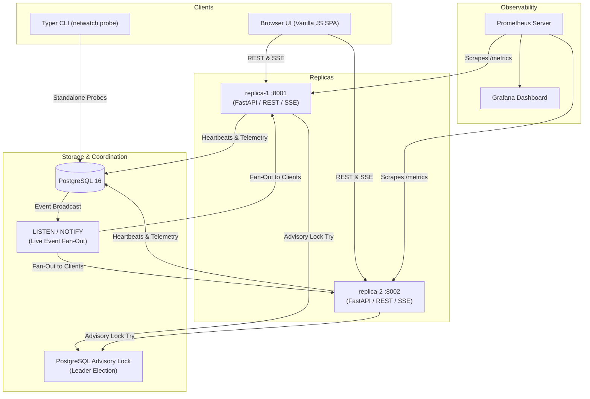

# NetWatch Architecture

NetWatch is a resilient, distributed network health monitoring service. It executes multi-phase latency and availability probes against target endpoints, persists historical telemetry in PostgreSQL, coordinates active leadership across multiple replicas via PostgreSQL advisory locks, and streams live telemetry to clients over Server-Sent Events (SSE).

## Distributed Topology

## Core Tenets

1. **Active-Standby Redundancy**:
   - Both replicas run the identical codebase and container image, differing only by their `REPLICA_ID` environment variable.
   - Both replicas actively accept read-only queries and write requests behind API-key RBAC.
   - Only the **LEADER** replica executes background probe tasks to prevent duplicated network traffic.
   - The leader holds a dedicated long-lived PostgreSQL advisory lock. If the leader crashes or drops connection, the lock is released instantly, enabling the standby to promote itself.

2. **Database Schema (PostgreSQL 16)**:
   - `targets`: Registered endpoints to probe (`id`, `host`, `port`, `interval_s`, `enabled`, `created_at`).
   - `results`: Detailed phase latency measurements (`id`, `target_id`, `ts`, `ok`, `dns_ms`, `tcp_ms`, `tls_ms`, `http_ms`, `total_ms`, `status_code`, `tls_days_left`, `error`, `replica_id`, `epoch`).
   - `api_keys`: Hashed credentials enforcing Role-Based Access Control (`id`, `key_hash`, `role` in `admin` | `viewer`, `label`).
   - `replica_heartbeats`: Active node registry updated every 2s (`replica_id` PK, `role`, `last_seen`, `started_at`).
   - `leadership`: Singleton tracking election state (`epoch`, `holder`, `acquired_at`).
   - `events`: Audited cluster transitions and probe status alerts (`id`, `ts`, `kind`, `replica_id`, `detail`).

3. **REST API Interface** (`/api`, Authenticated via `X-API-Key`):
   - `GET /healthz` (Public, unauthenticated container liveness probe).
   - `GET /metrics` (Public, Prometheus scrape target).
   - `GET /api/targets` (Viewer & Admin: list monitored targets).
   - `POST /api/targets` (Admin only: register new target with validation).
   - `DELETE /api/targets/{id}` (Admin only: remove target).
   - `GET /api/results` (Viewer & Admin: query recent probe executions).
   - `GET /api/summary` (Viewer & Admin: aggregated cluster latency and health statistics).
   - `GET /api/targets/{id}/series` (Viewer & Admin: time-series latency vectors for charts).
   - `GET /api/cluster` (Viewer & Admin: active replicas and current leader).
   - `GET /api/events` (Viewer & Admin: audit log).
   - `GET /api/export.csv` (Viewer & Admin: raw export).
   - `GET /api/stream` (Viewer & Admin: real-time SSE stream).

4. **Multi-Phase Probe Pipeline**:
   - Every network check executes 4 discrete phases: **DNS Resolution**, **TCP Connect**, **TLS Handshake & Expiry**, and **HTTP TTFB**.
   - Timing is recorded in milliseconds per phase using monotonic clocks (`time.perf_counter()`).
   - A failed probe is captured as structured failure data rather than an unhandled application exception.
