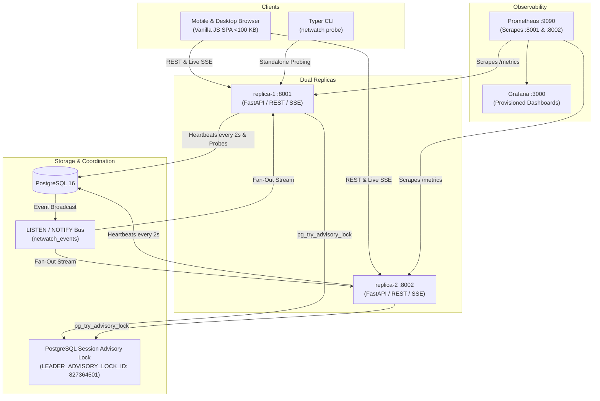

# NetWatch: Distributed Network Health Monitor

NetWatch is an active-standby, multi-phase network availability and latency monitoring service. It continuously probes endpoints across discrete network protocol stages (DNS resolution, TCP connection, TLS handshake/certificate expiry, and HTTP TTFB), records telemetry into PostgreSQL with monotonic epoch fencing, coordinates automated replica failover via PostgreSQL advisory locks, and broadcasts live telemetry over Server-Sent Events (SSE) to a mobile-first single-page dashboard.

---

## 3-Command Quick Start

```bash
# 1. Clone the repository and navigate into the project directory
git clone https://github.com/example/netwatch.git && cd netwatch

# 2. Copy the sample environment configuration and start the cluster
cp .env.example .env && docker compose up -d

# 3. Verify health on replica-1
curl -s http://localhost:8001/healthz
```

Once running, access:
* **Web Dashboard**: [http://localhost:8001/](http://localhost:8001/) or [http://localhost:8002/](http://localhost:8002/) (Viewer Key: `netwatch-viewer-secret-key-456`, Admin Key: `netwatch-admin-secret-key-123`)
* **Prometheus**: [http://localhost:9090](http://localhost:9090)
* **Grafana**: [http://localhost:3000](http://localhost:3000) (User: `admin`, Password: `admin`)

---

## Architecture Topology



---

## Visual Interface & Responsive Screen Captures

NetWatch features a mobile-first, responsive interface built with zero UI frameworks, adhering strictly to 44px minimum touch targets, WCAG 4.5:1 text contrast, and no horizontal scroll at 360px viewport widths.

All full-fidelity screen captures are available in [`docs/screens/`](docs/screens/):

| View | Mobile (390px) | Desktop (1280px) |
| :--- | :--- | :--- |
| **Cluster Overview** | [`overview_390px.png`](docs/screens/overview_390px.png) | [`overview_1280px.png`](docs/screens/overview_1280px.png) |
| **Targets Card List** | [`targets_390px.png`](docs/screens/targets_390px.png) | [`targets_1280px.png`](docs/screens/targets_1280px.png) |
| **Target Detail & Series** | [`target_detail_390px.png`](docs/screens/target_detail_390px.png) | [`target_detail_1280px.png`](docs/screens/target_detail_1280px.png) |
| **Cluster & Failover Timeline** | [`cluster_390px.png`](docs/screens/cluster_390px.png) | [`cluster_1280px.png`](docs/screens/cluster_1280px.png) |
| **Add Target Bottom Sheet** | [`add_target_modal_390px.png`](docs/screens/add_target_modal_390px.png) | [`add_target_modal_1280px.png`](docs/screens/add_target_modal_1280px.png) |
| **Settings & Auth** | [`settings_390px.png`](docs/screens/settings_390px.png) | [`settings_1280px.png`](docs/screens/settings_1280px.png) |

---

## Running Verification Commands

### 1. Automated Leader Failover Demonstration
Simulates both sudden hard process termination (`SIGKILL`/`docker kill`) and graceful planned shutdown (`SIGTERM`/`docker stop`):
```bash
scripts/failover_demo.sh
```

### 2. Performance Benchmark (k6 Load Test)
Runs load tests against `/api/summary`, `/api/results`, and `/api/targets` using the viewer role:
```bash
scripts/loadtest.sh
```

### 3. End-to-End Smoke Test
Brings up cluster services, verifies health, target seeding, telemetry writes, SSE live streaming, Prometheus metrics, and automated leader promotion:
```bash
scripts/smoke.sh --clean
```

---

## Design Decisions

NetWatch incorporates five core architectural decisions:

1. **Active-Standby Redundancy via PostgreSQL Session Advisory Locks**:
   Instead of introducing ZooKeeper, etcd, or Consul, NetWatch leverages PostgreSQL's session-level advisory locks (`pg_try_advisory_lock(827364501)`). When the leader process crashes or disconnects, the TCP session drops and PostgreSQL immediately releases the lock, enabling the standby to promote in ~2 seconds with zero external coordination infrastructure.

2. **Monotonic Epoch Fencing on Telemetry Writes**:
   To prevent split-brain zombies (e.g. an ex-leader that was frozen in a garbage collection pause or network partition suddenly waking up and overwriting newer data), all `INSERT INTO results` queries are conditional:
   ```sql
   INSERT INTO results (...) SELECT ... WHERE COALESCE((SELECT epoch FROM leadership), 0) = :epoch;
   ```
   Any probe execution from an obsolete epoch is rejected and increments `netwatch_fenced_writes_total`.

3. **Single Shared Database with LISTEN/NOTIFY Event Bus**:
   Rather than embedding Redis or RabbitMQ for pub/sub messaging, NetWatch uses PostgreSQL's native `pg_notify('netwatch_events', payload)` and `asyncpg` listener connections. This keeps operational complexity minimal while fanning out live events to all connected Server-Sent Events clients.

4. **Multi-Phase Isolated Monotonic Telemetry**:
   Each probe sequentially executes DNS resolution, TCP connection, TLS negotiation, and HTTP response timing using `time.perf_counter()`. If DNS resolution fails, the remaining phases are skipped cleanly, recording the specific failing phase without throwing unhandled exceptions.

5. **Ultra-Lightweight Mobile-First Vanilla SPA**:
   The entire browser client is implemented in pure vanilla HTML5, CSS3, and JavaScript totaling under 100 KB (`96.02 KB` combined). It avoids JavaScript framework build pipelines, bundlers, and heavy CSS preprocessors, ensuring instant initial load time and transparent explainability in technical interviews.

---

## Why Not Prometheus blackbox_exporter?

| Dimension | NetWatch | Prometheus `blackbox_exporter` |
| :--- | :--- | :--- |
| **Topology** | Distributed active-standby cluster with dual replicas and leader election. | Stateless HTTP daemon intended to be deployed as a single instance or sidecar. |
| **Target Management** | Dynamic REST API with role-based access control and live UI bottom sheet. | Static Prometheus scrape targets configured in YAML manifests or service discovery. |
| **Telemetry Storage** | Persistent PostgreSQL storage with 7-day retention and analytical endpoints. | Ephemeral; retains nothing locally and relies entirely on Prometheus scraping. |
| **Real-Time Client Updates** | Native Server-Sent Events stream delivering sub-second live push to the browser. | Pull-only Prometheus scrape intervals (typically 15s to 60s). |

### What NetWatch Does Differently:
* Combines active probe execution, persistence, live streaming, and a dedicated mobile-first dashboard into a single cohesive system without external dependencies.
* Dynamic CRUD management of monitored endpoints without restarting services or modifying YAML configurations.

### What NetWatch Does Worse:
* **Stateful Dependency**: Relies on PostgreSQL. If PostgreSQL goes offline, leader election and telemetry persistence fail entirely. `blackbox_exporter` is completely stateless and resilient to storage outages.
* **Protocol Diversity**: `blackbox_exporter` natively supports ICMP ping, raw TCP/UDP streams, DNS over TLS/HTTPS, and gRPC health checking out of the box. NetWatch focuses on DNS, TCP, TLS, and HTTP.
* **Global Distribution**: `blackbox_exporter` can be easily scattered across 20+ AWS/GCP regions to scrape probes from the edge without shared database latency.

### What Was Learned:
* Pure asynchronous I/O (`asyncio`, `dnspython`, `httpx`) is essential to prevent slow or unresponsive target hosts from bottlenecking active scheduler loops.
* Session-level advisory locks provide an exceptionally simple yet robust mechanism for high-availability leader failover when a relational database is already part of the core tech stack.

---

## Limitations

1. **PostgreSQL Single Point of Failure**: Both replicas rely on a single primary PostgreSQL instance for advisory lock leader election, heartbeats, and result persistence.
2. **Single Region Deployment**: Designed for local or single-datacenter operation; latency measurements reflect probes from the hosting provider rather than global vantage points.
3. **No Direct Alert Routing**: NetWatch exposes Prometheus metrics and SSE events but does not directly route pages to PagerDuty or Opsgenie (alerts should be routed via Prometheus Alertmanager).
4. **Coarse Retention Pruning**: Telemetry older than `RETENTION_DAYS` (default 7 days) is pruned via an hourly scheduled cleanup job without downsampling into long-term rollups.
5. **Single-Tenant Role Model**: Simple authentication model with cluster-wide Admin and Viewer API keys; no multi-tenant organizational isolation.
